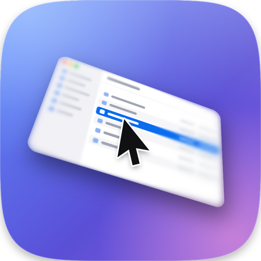
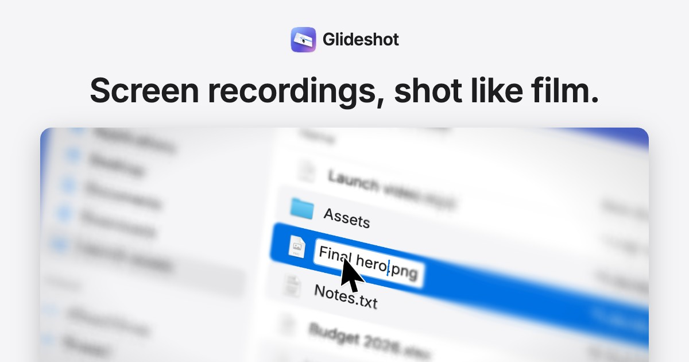

<p align="center">
  
</p>

<h1 align="center">Glideshot</h1>

<p align="center">
  <b>Screen recordings, shot like film.</b><br>
  A Mac screen recorder with a virtual camera that tilts, zooms and follows your cursor.
</p>

<p align="center">
  <a href="https://glideshot.xyz">Website</a> ·
  <a href="https://github.com/ryanshahine/glideshot/releases/latest/download/Glideshot.zip">Download</a> ·
  <a href="https://glideshot.xyz/install/">Install guide</a> ·
  <a href="https://glideshot.xyz/blog/">Blog</a>
</p>



Glideshot records your screen, then films it the way a camera would: the screen is tilted in 3D, zoomed in and
blurred away from the action. The camera follows your cursor like a camera operator, or stays locked on one spot.
Because it keeps the raw recording, you can change the angle, focus and blur afterwards.
[Try the camera in your browser.](https://glideshot.xyz)

## Features

- **Record first, style later.** A take is the raw screen plus the mouse, click and typing activity. Restyle it in
  the editor and export it as often as you like.
- **A camera with judgment.** Dead zone, look ahead, zoom in on clicks and typing, zoom out on fast moves, pull back
  when idle, handheld drift, intro and outro.
- **A real lens.** 3D angle (pitch, yaw, roll, perspective), depth of field that follows the cursor, motion blur,
  vignette.
- **A cursor you can follow.** Larger and smoothed, with click ripples, and it hides when idle if you want.
- **Every format from one take.** 16:9, 16:10, 4:3, 1:1, 4:5 and 9:16 at 1080p, 1440p or 4K, 30 or 60 fps, H.264
  or HEVC.
- **Private.** No network access, no account, no analytics. It only records *that* a key was pressed (for
  auto-zoom), never which key.

Every behavior has its own switch. Not there yet: audio, trimming.

## Install

You need a Mac with Apple silicon and macOS 14 Sonoma or later.

1. [Download Glideshot.zip](https://github.com/ryanshahine/glideshot/releases/latest/download/Glideshot.zip),
   unzip it and move Glideshot to Applications.
2. Open it. Glideshot isn't notarized, so macOS blocks the first launch. Click **Done**, go to
   **System Settings → Privacy & Security**, click **Open Anyway** and confirm.
   On macOS 14, Control-click the app and choose **Open** instead.
3. Allow **Screen Recording** when asked, then quit and reopen Glideshot.

If you prefer Terminal, `xattr -dr com.apple.quarantine /Applications/Glideshot.app` replaces step 2. The
[install guide](https://glideshot.xyz/install/) covers troubleshooting.

## Using it

1. Frame the shot in the main window and press **Record**.
2. Stop, and the take opens in the editor.
3. Adjust the look while it plays, tick any extra formats under **Also export as…**, and export.

| Shortcut | |
| --- | --- |
| `⌃⌥⌘R` | Start or stop recording |
| `⌃⌥⌘L` | Lock the camera at the mouse, or follow again |
| `⌃⌥⌘=` / `⌃⌥⌘-` | Zoom in / out |
| `Space` | Play or pause (editor) |

The shortcuts work from any app and are listed in the menu bar menu. While recording, the menu bar icon shows a red
dot and a timer. **Hide Glideshot while recording** hides the windows, Dock icon and menu bar icon during a take.
Takes are saved in `~/Movies/Glideshot/Takes`, exports in `~/Movies/Glideshot`.

## Build from source

All you need is the Xcode Command Line Tools (`xcode-select --install`, Swift 5.10 or newer).

```bash
git clone https://github.com/ryanshahine/glideshot.git
cd glideshot
./build.sh
open build/Glideshot.app
```

`build.sh` signs ad hoc, so macOS asks for Screen Recording permission again after each rebuild. To avoid that, sign
with your own development certificate: `SIGN_IDENTITY="Apple Development: …" ./build.sh`. `scripts/package.sh` makes
the release download (`dist/Glideshot.zip`, always signed ad hoc).

For testing without Screen Recording permission, there's a small command line:

```bash
# Render one frame of the effect from any screenshot
build/Glideshot.app/Contents/MacOS/Glideshot --render-test screenshot.png out.png 0.5 0.4
# Export a take with its saved look
build/Glideshot.app/Contents/MacOS/Glideshot --export ~/Movies/Glideshot/Takes/<take>
```

Environment variables: `GLIDESHOT_DEFAULTS=1` ignores saved settings, `GLIDESHOT_ASPECT=9:16` picks the format,
`GLIDESHOT_OUTPUT=<folder>` changes where exports go, `GLIDESHOT_DEBUG=1` prints the camera path.

## How it works

Swift and SwiftUI, with no dependencies. ScreenCaptureKit captures the screen without the cursor, Core Image (on
Metal) renders the look, and AVFoundation writes the video. Takes are fragmented movies, so a crash still leaves a
playable file.

| File | What it does |
| --- | --- |
| `Director.swift` | The virtual camera operator: springs, dead zone, look ahead, intent-based zoom, drift |
| `Renderer.swift` | The look: 3D projection, depth of field, cursor, click ripples, motion blur, vignette |
| `CaptureEngine.swift` | Screen capture, live preview, raw take recording |
| `InputMonitor.swift` | Mouse, click and typing activity (no extra permissions needed) |
| `Editor.swift`, `Exporter.swift` | The editor window and offline export |
| `AppModel.swift`, `Views.swift`, `StatusBar.swift` | App state, recording flow, controls, menu bar |

[`site/`](site) is the website: a live WebGL port of the camera, plus the blog and install guide, pre-rendered
to static HTML.

## Contributing

Issues and pull requests are welcome. For bigger changes, open an issue first so we can talk it through.

## License

[MIT](LICENSE). Built by [Ryan Shahine](https://ryanshahine.me).
